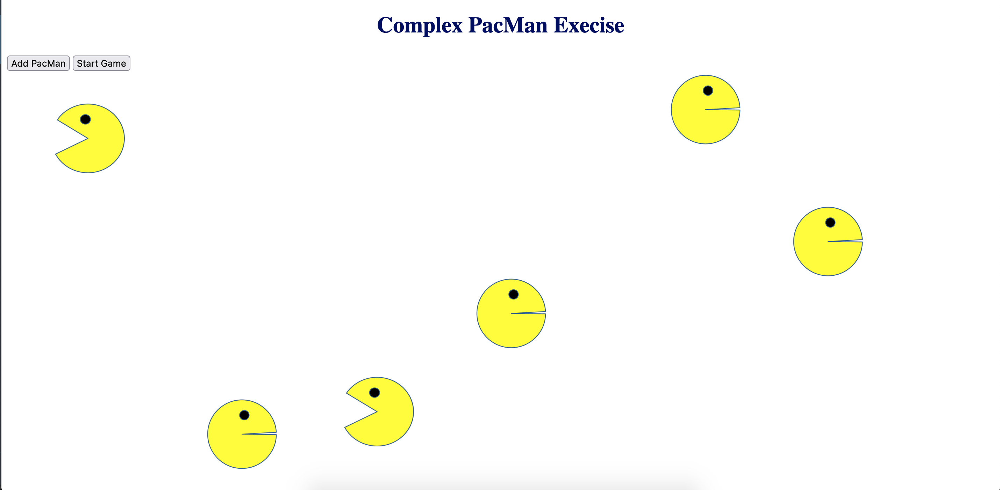

# Pac-Man Exercise
## Pac-Man Exercise
A simple pac man visualization exercise. Watch pacman bounce all over the screen. Click to add more pac mans. Add as many pac mans as you want.

### Version 2
- Pac-Men bounce around inside a game box, so they never cover the buttons.
- **Start Game** turns into **Pause** while the game is running.
- Click or tap inside the box to add a Pac-Man right where you clicked.
- New Pac-Men head off in any direction.
- The game runs on `requestAnimationFrame`, with speeds in pixels per second, so it moves at the same pace on any screen.

The code is split into `index.html` (the page), `style.css` (the look) and `pacman.js` (the program).

### History
- [Bootcamp original](https://github.com/vegan-morpheus/Pac-Man-Exercise/tree/bootcamp-original): the exercise as built for the MIT bootcamp. Pac-Men briefly turned into a broken image when they bounced off a side wall, because the bounce code pointed at an `img/` folder instead of `images/`.
- [Version 1, fixed](https://github.com/vegan-morpheus/Pac-Man-Exercise/tree/04ec02c): the original with that glitch and a few other bugs fixed.
- Version 2: this one.

### Practice
[PRACTICE.md](PRACTICE.md) turns every fix and improvement into an exercise, starting from the bootcamp original, with each commit as the answer.

<a href="https://vegan-morpheus.github.io/">My Portfolio</a>
